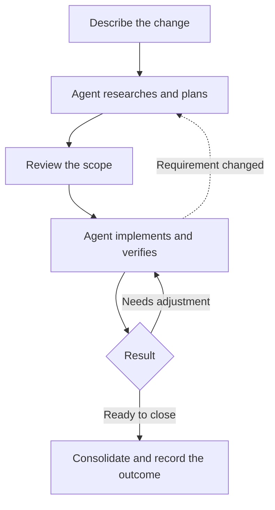
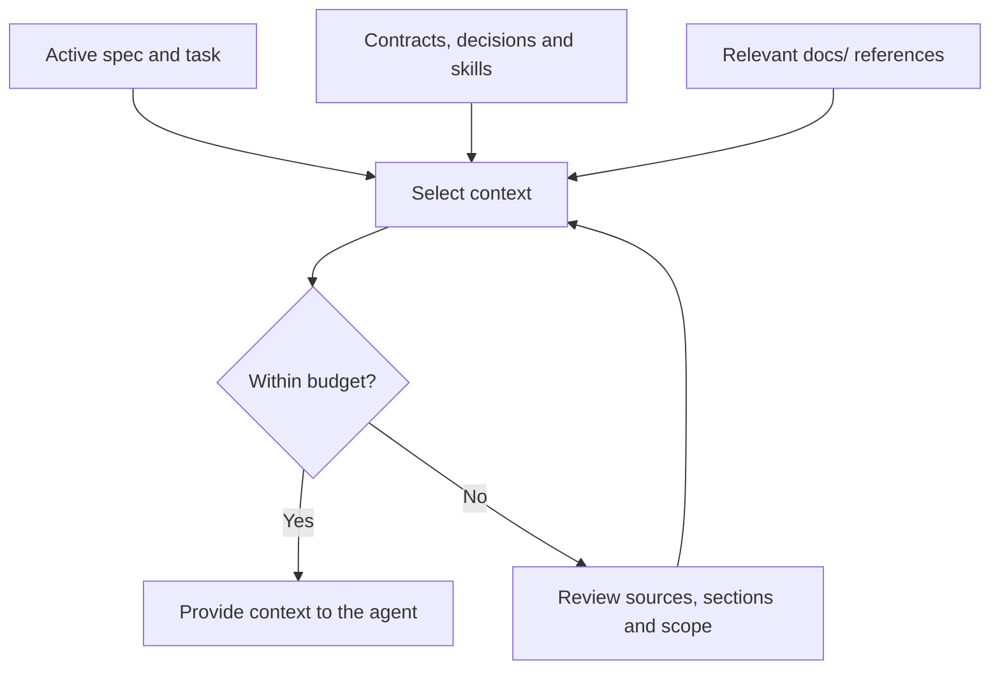

<div align="center">

# sdd-flow

### A clear workflow for developing with AI.

Relevant context for the agent.<br>
Well-defined changes for you.<br>
A traceable history for the project.


[Português brasileiro](README.pt-BR.md) · [Get started](#get-started-in-3-steps) · [Workflow](#how-it-works) · [Context](#how-context-stays-focused) · [Documentation](#documentation)

</div>

---

**sdd-flow organizes AI-assisted development into cohesive changes that you can understand, implement and verify.**

Describe what you need. The agent consults relevant sources, prepares a spec, implements the authorized scope and records the results. Project knowledge and progress remain in the repository for the next session.

| Organization | Context | Traceability |
|---|---|---|
| One spec per cohesive change | Sources selected for the phase and task | Connected requirements, tasks, decisions and verification |

**Your daily focus stays on the spec.** The agent and CLI maintain supporting records. Configuration, skills and general documents are consulted when relevant.

## How it works



**Research → plan → implement → validate → close.** These are responsibilities, not mandatory separate conversations.

- **Before:** clarify the goal, define acceptance and consider affected consumers.
- **During:** execute cohesive tasks and check regressions.
- **After:** record observations and consolidate current knowledge.

Use the method for **new projects** or **existing applications**, with any application stack. Node.js 22+ is required for the CLI.

## Get started in 3 steps

> **This README describes 2.1.** Flexible spec management is new in this release. Confirm your CLI with `sdd --version`.

### 1. Install the CLI

With Node.js 22+:

```sh
npm install -g sdd-flow
sdd --version
```

<details>
<summary>Other options: run without installing, or from source</summary>

Run without a global install:

```sh
npx sdd-flow@latest --help
```

From the **sdd-flow source checkout** (for contributors):

```sh
npm ci
npm link
sdd --version
```

Installing the package provides the CLI. Project files are installed by running `sdd init` inside each application.

</details>

### 2. Initialize your project

```sh
cd /path/to/your-project
sdd init
```

Optional native entry points:

```sh
sdd harness claude-code
# Alternative: sdd harness opencode
```

For other environments, direct the agent to the project's `AGENTS.md`. The core uses files and commands; a native adapter is optional.

### 3. Keep using short prompts

For initial setup:

```text
Read and follow agents/SETUP.md to configure the workflow.
```

Then describe the change and select the phase:

| Phase | Prompt |
|---|---|
| Research | Read and follow agents/prompts/rpi-research.md. |
| Plan | Read and follow agents/prompts/rpi-plan.md. |
| Implement | Read and follow agents/prompts/rpi-implement.md. |
| Validate | Read and follow agents/prompts/rpi-validate.md. |
| Close | Read and follow agents/prompts/rpi-close.md. |

The procedures contain the workflow instructions. You do not need to repeat them in chat.
The request and active spec must be identifiable. If several changes exist or a new session lacks context,
provide the spec ID or let the agent clarify which one to use.

Setup is initial adoption, not a repeated step for every spec. Once complete, `SETUP.md` may be removed.
Project language and conventions belong in configuration and policies.

**Follow the spec, tasks and verification outcome.** The agent uses the CLI and maintains supporting records.
Phases may run in the same conversation.

For an existing application, setup records an observed baseline without refactoring the application
or inventing historical specs.

## What is added to your repository

| Files | Purpose |
|---|---|
| `AGENTS.md` and `QUICKSTART.md` | Entry point and getting started |
| `agents/PROJECT.md` | Short application map and source references |
| `agents/POLICIES.md` and `agents/QUALITY.md` | Project constraints and quality criteria |
| `agents/config.yaml` | Language, autonomy, rigor and actual check commands |
| `agents/RULES.md`, `agents/AGENTS.md` and `agents/prompts/` | Method and phase procedures |
| `agents/specs/` | Active changes |
| `agents/current/` and active decisions | Current knowledge |
| `agents/archive/` | Closed changes |
| `agents/skills/` | Reusable project procedures |

Installation includes templates and maintenance metadata. **It does not generate features or fictional specs.**

Each change uses only the applicable artifacts:

| Artifact | Role |
|---|---|
| `change.yaml` | Identity, references, dependencies and lifecycle |
| `SPEC.md` | Requirements and acceptance |
| `TASK.md` | Plan and canonical task state, when applicable |
| `RESEARCH.md` | Research when useful or required by the mode |
| Evidence and run records | What was checked, for which inputs, with which result |

The agent maintains these as work progresses. Research, evidence and history are not all created by `sdd new`.

## How context stays focused

**The repository stores knowledge. The agent receives a relevant selection for the current task.**



- A short entry point maps the project.
- Phase and task guide selection.
- Skills are discovered by name and description; selected bodies are loaded.
- Large references can be selected by heading.
- Full historical logs are not loaded automatically.
- `TASK.md` holds task state; `STATE.md` is an optional short resumption note.

```sh
sdd context 001-my-change --phase implement --task T01 --inspect
```

Inspection reports sizes without emitting document bodies. The default budget is **48,000 UTF-8 bytes**,
configurable. It is not a token count or the complete chat context window.

Generating an oversized packet reports the problem **without silently truncating content**.
The agent can select sections, review references or split independent deliverables.

Selection depends on maintained references. The CLI cannot infer every semantic dependency or control chat history.

## Keep references organized in docs/

PRDs, business rules, system design, ADRs, design systems, contracts and external materials can stay
in `docs/`, with or without subdirectories.

**Centralize sources; select what to read.** The agent consults relevant documents and preserves their origin.

Example in `change.yaml`:

```yaml
sources:
  - path: docs/product/prd.md
    section: Data export
context:
  - path: docs/design/design-system.md
    section: States and interactions
```

There is no mandatory document bundle. A clear description can be enough to start.

Optional reference drafts:

```sh
sdd docs --types prd,sd,ds,adr,roadmap --dry-run
sdd docs --types prd,sd,ds,adr,roadmap
```

Existing files are preserved. New files are drafts for review.
See [setup and reference documents (Português)](docs/setup-documents.pt-BR.md).

## Organize specs without restarting work

Folder names and visual numbers can change while the manifest ID stays stable.
Archive unfinished specs, restore them or remove obsolete content. Removal is recoverable by default;
permanent deletion is explicit.

Missing historical references warn. Unknown prerequisites need local review, without restarting
the consumer or inventing completion.

<details>
<summary>Rename, archive, restore and discard</summary>

```sh
sdd rename 015-export --name export-reports --number 3 --by "Reviewer" --reason "Organize" --dry-run
sdd archive 015-export --by "Reviewer" --reason "Remove from active work"
sdd restore 015-export --by "Reviewer" --reason "Resume"
sdd remove 015-export --by "Reviewer" --reason "Obsolete" --dry-run
sdd reconcile --dry-run
sdd status --all
```

Use actual IDs and review previews. Rename preserves ID 015-export even with folder 003-export-reports.
Reconcile updates observed inventory only; it does not rewrite requirements or manufacture evidence.
Current contracts remain available independently of historical spec folders.
See [spec management (Português)](docs/spec-management.pt-BR.md) for application, permanent discard and recovery.

</details>

## Choose proportional rigor

| Mode | Typical use |
|---|---|
| `light` | Small change; tasks and research may be omitted |
| `standard` | Bounded feature with verifiable tasks |
| `rigorous` | Sensitive or uncertain work with research and explicit approval |

New installations default to **step**: implement and verify one task, then stop for review.
Authorize named tasks or all tasks to continue as a bounded batch without repeated confirmations.
Plan approval alone does not override step. **Batch** can also be the project's standing preference;
updates preserve an existing choice. Each task is still checked and dependencies respected.

## Verify honestly, including unavailable environments

The CLI runs configured checks and records commands, results and inputs.
Approval binds to scope; verification binds to the inputs examined.

| Result | Meaning |
|---|---|
| `passed` | Full verification passed for current inputs |
| `limited` | Implementation complete with explicit external limitations and pending verification |
| `partial` | Conditions for final closure are not yet met |
| `failed` | Required failure observed or inputs changed during execution |

**Unavailable staging or production access need not block completed implementation.**
A reviewed handoff records limitations and can generate safe steps in `USER_TESTS.md`.

`limited` does not claim external tests passed or authorize deployment.
Omitting evidence cannot erase a known failure for the same inputs.

Required failures block passing verification; advisory issues remain warnings.
Use TDD, BDD examples and metrics as appropriate, without a mandatory tool or universal percentage.

See [quality gates and missing environments (Português)](docs/quality-gates.pt-BR.md).

## Portability and scope

| sdd-flow organizes | The harness provides |
|---|---|
| Method, specs, context and traceability | Models, tools and permissions |
| Sources and evidence | MCPs and service access |
| Knowledge entry points and exports | Compaction and optional delegation |

Use one conversation, separate sessions or native delegation. **No built-in orchestrator or multiagent requirement.**

Claude Code and OpenCode adapters provide commands and a workflow skill.
Exports prepare knowledge for distribution; they do not publish to marketplaces.
See [adapters and distribution](docs/distribution.md).

## For AI agents

1. Start with `AGENTS.md` and the project map.
2. Follow `SETUP.md` for initial adoption, then the current phase procedure.
3. Consult relevant sources instead of bulk-loading `docs/`.
4. Preserve IDs, current rules, observed architecture and existing work.
5. Review consumers and regressions before changing shared behavior.
6. Record actual authorization, observations and limitations.
7. Maintain canonical state and consolidate current knowledge before closure.

Metadata uses YAML rather than fixed line excerpts. Source documents are project data;
they do not replace user authorization.

<details>
<summary>Essential change commands</summary>

Use the actual ID and complete the plan between commands:

```sh
sdd new my-change --mode standard
sdd context 001-my-change --phase plan
# Define requirements, acceptance, tasks and references.
sdd check 001-my-change

# Record only authorization actually given:
sdd approve 001-my-change --by "Reviewer"

sdd context 001-my-change --phase implement --task T01
# Implement, check and update tasks.
# Consolidate current contracts before final verification.
sdd verify 001-my-change
sdd close 001-my-change --by "Reviewer" --archive
```

Closure requires consolidation of selected capabilities, or `--note` explaining why no lasting update is needed.
Manual evidence and external limitations use the corresponding verification arguments.

`sdd check` validates structure. `sdd verify` executes configured checks.

</details>

## Reinstall or upgrade without starting over

The 2.x installer distinguishes project-owned files from managed workflow files.

| Situation | Expected behavior |
|---|---|
| Repeat `init` on the same version | Preserve configuration and work; missing files may be restored |
| Customized core files | Report conflicts rather than silently overwrite |
| Install a newer CLI | Existing application files are not updated automatically |
| Run `update` with recognized, conflict-free core files | Refresh managed files and preserve project-owned files |
| Adopt from 1.x | Review core/artifact migration; old evidence does not become fresh approval |

Existing `PROJECT.md`, `POLICIES.md`, `QUALITY.md`, `config.yaml` and `DECISIONS.md` are preserved.
The installer does not delete project specs, custom skills, `docs/` sources or history.
Normal maintenance does not recreate a completed, removed setup guide.

Preserve your current work in a commit or backup. Install the desired CLI version from npm
(or from the source checkout when testing). Inside the application:

```sh
sdd --version
sdd update --dry-run
# Review the plan and resolve conflicts before applying.
sdd update
sdd doctor
```

Refresh native entry points with `sdd harness claude-code` or `sdd harness opencode` when used.
Native settings are not overwritten; old permissions/hooks require their own review.

<details>
<summary>Migrating from 1.x or handling a conflict</summary>

The updater recognizes unchanged templates from the original 1.3.3 baseline.
Customized versions, including third-party adaptations, may need manual review.

For a legacy spec that you will resume or normalize:

```sh
sdd migrate 001-my-change --dry-run
sdd migrate 001-my-change
```

Use the real ID. Migration preserves old bodies and creates structures for review.
Review requirements, acceptance, tasks and references before normalization.
You do not need to convert all closed historical work just to adopt the flow for new changes.

Customized core files cause a conflict before planned core writes are applied.
Move project-specific rules into policies, contracts or skills before deciding to replace core files.
`--replace-managed` is explicit and should follow review; replaced content is backed up.

These protections describe the 2.x installer. Do not use a 1.x installer to downgrade
or assume automatic compatibility with future versions.
Read the [migration guide](docs/migration.md).

</details>

## Documentation

| Goal | Guide |
|---|---|
| Use the workflow end to end | [Usage (Português)](docs/usage.pt-BR.md) |
| Understand setup and documents | [Setup (Português)](docs/setup-documents.pt-BR.md) |
| Understand the method and changes | [Methodology (Português)](docs/methodology.pt-BR.md) |
| Configure quality and external tests | [Quality gates (Português)](docs/quality-gates.pt-BR.md) |
| Understand artifact formats | [Formats and examples](docs/formats.md) |
| Test locally | [Local testing (Português)](docs/local-testing.pt-BR.md) |
| Upgrade legacy projects | [Migration](docs/migration.md) |
| Prepare plugins and skills | [Distribution](docs/distribution.md) |
| Review observed validation and limits | [Implementation validation](docs/validation.md) |
| Publish a version | [GitHub and npm (Português)](docs/releases.pt-BR.md) |
| Contribute | [Contributing](CONTRIBUTING.md) · [Changelog](CHANGELOG.md) |

## Important limits

The CLI validates declared relationships and records runs. Passing tests do not prove semantic coverage.
Approval is a recorded assertion, not identity authentication.

Configured commands run with current account permissions; the CLI is not a sandbox.
Review settings, use native harness controls and choose safe environments.

Context selection avoids unnecessary reading; no universal cost or generated-code improvement is claimed.
Interactive adapter compatibility must be checked against the actual tool versions in use.

## License

[MIT](LICENSE).
