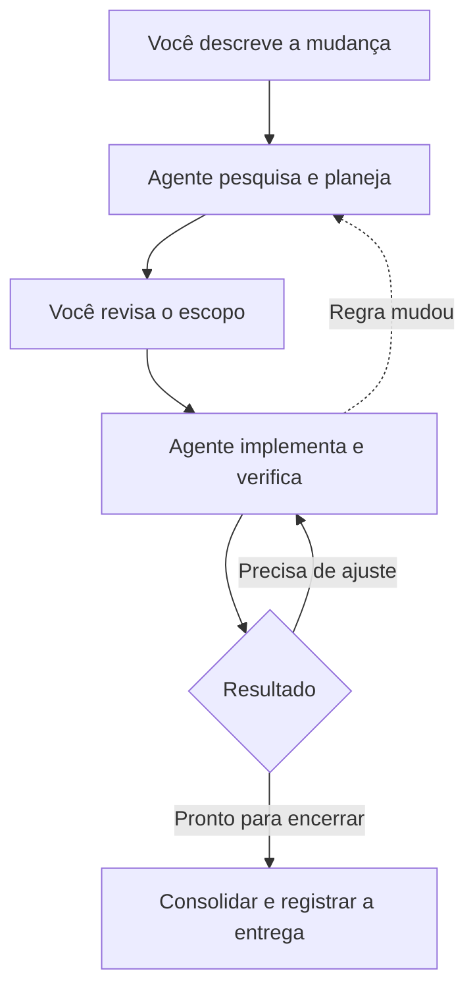
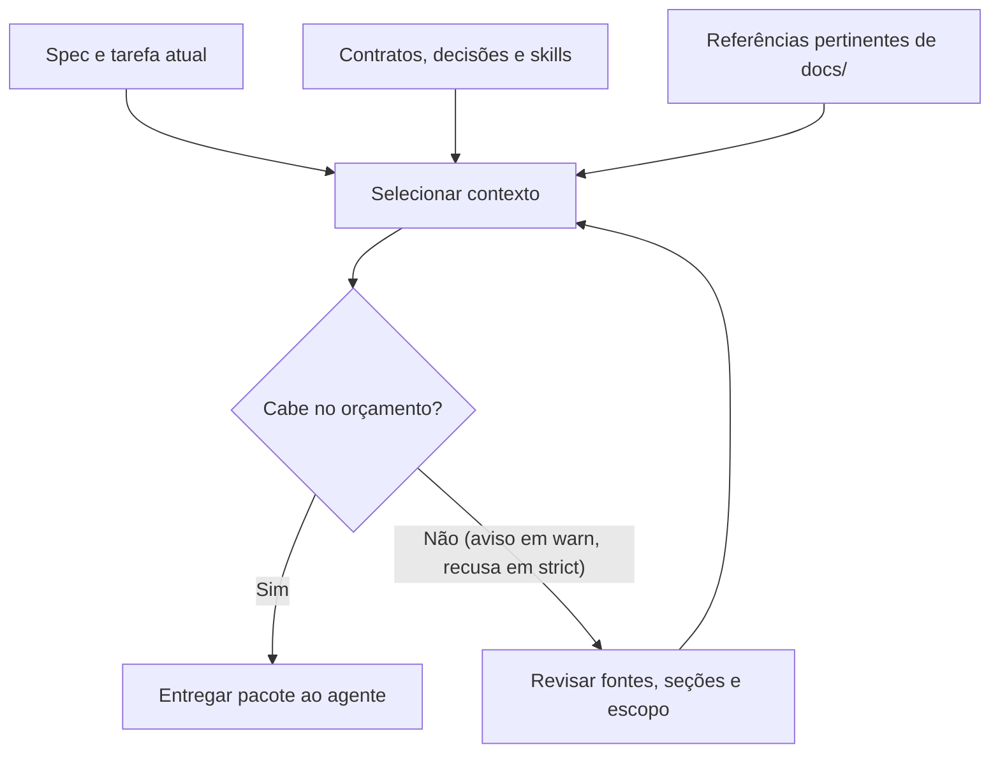

<div align="center">

# sdd-flow

### Um fluxo claro para desenvolver com IA.

Contexto relevante para o agente.<br>
Mudanças bem definidas para você.<br>
Histórico rastreável para o projeto.


[English](README.md) · [Começar](#comece-em-3-passos) · [Entender o fluxo](#como-funciona) · [Contexto](#como-o-contexto-permanece-enxuto) · [Documentação](#documentação)

</div>

---

**O sdd-flow organiza o desenvolvimento assistido por IA em mudanças pequenas o suficiente para entender, implementar e verificar.**

Você descreve o que precisa. O agente consulta as referências pertinentes, prepara uma spec, implementa o escopo autorizado e registra os resultados. O conhecimento e o andamento permanecem no repositório, disponíveis para a próxima sessão.

| Organização | Contexto | Rastreabilidade |
|---|---|---|
| Uma spec por mudança coesa | Fontes selecionadas por fase e tarefa | Requisitos, tarefas, decisões e verificações conectados |

**No dia a dia, seu foco continua na spec.** O agente e o CLI mantêm os registros de apoio. Configuração, skills e documentos gerais são consultados quando pertinentes.

A versão 3 usa specs em Markdown legível e registros técnicos locais. Specs existentes mantêm seu formato até conversão explícita; consulte o [guia de migração](docs/migration.md).

## Como funciona



**Pesquisar → planejar → implementar → validar → encerrar.** As etapas são responsabilidades do trabalho; podem acontecer na mesma conversa.

- **Antes:** esclarecer o objetivo, definir aceitação e considerar impactos.
- **Durante:** executar tarefas coesas e verificar regressões.
- **Depois:** registrar o que foi observado e atualizar o conhecimento vigente.

O framework serve tanto para **projetos novos** quanto para **aplicações em desenvolvimento**, com qualquer stack. Node.js 22+ é necessário para o CLI, não para a aplicação que você está construindo.

## Comece em 3 passos

> **Versão deste README: 2.1.** A gestão flexível de specs é nova nesta versão. Confira a versão com `sdd --version`.

### 1. Instale o CLI

Com Node.js 22+:

```sh
npm install -g sdd-flow
sdd --version
```

<details>
<summary>Outras opções: executar sem instalar ou pelo código-fonte</summary>

Executar sem instalação global:

```sh
npx sdd-flow@latest --help
```

Pelo código-fonte do **sdd-flow** (para quem contribui):

```sh
npm ci
npm link
sdd --version
```

Instalar o pacote disponibiliza o CLI. Os arquivos do método entram em cada aplicação ao executar `sdd init`.

</details>

### 2. Ative no seu projeto

```sh
cd /caminho/do/seu-projeto
sdd init
```

Usa Claude Code ou OpenCode? Você pode instalar seus pontos de entrada:

```sh
sdd harness claude-code
# Alternativa: sdd harness opencode
```

Em outros ambientes, indique ao agente o `AGENTS.md` do projeto. O núcleo usa arquivos e comandos, sem exigir um adaptador específico.

### 3. Use seus prompts habituais

Para configurar o projeto:

```text
Leia e siga as instruções do arquivo agents/SETUP.md para configurar o workflow.
```

Depois, apresente a demanda e indique a etapa. Prompts curtos continuam sendo suficientes:

| Etapa | Pedido ao agente |
|---|---|
| Pesquisa | Leia e siga as instruções do arquivo agents/prompts/rpi-research.md. |
| Planejamento | Leia e siga as instruções do arquivo agents/prompts/rpi-plan.md. |
| Implementação | Leia e siga as instruções do arquivo agents/prompts/rpi-implement.md. |
| Validação | Leia e siga as instruções do arquivo agents/prompts/rpi-validate.md. |
| Encerramento | Leia e siga as instruções do arquivo agents/prompts/rpi-close.md. |

Os procedimentos contêm as instruções do método; você não precisa repeti-las no chat.
A demanda e a spec precisam estar identificadas. Se houver várias mudanças ou uma sessão sem contexto,
informe o ID, como “Use a spec 001-exportar-dados”, ou deixe o agente esclarecer essa ambiguidade.

O setup é inicial. Depois de concluído, `SETUP.md` pode ser removido; não é necessário refazê-lo a cada spec.
Idioma e padrões particulares ficam na configuração e nas políticas do projeto.

**Seu foco continua na spec, nas tarefas e no resultado da validação.** O agente usa o CLI e mantém
os registros de apoio. Você pode acompanhar as etapas na mesma conversa.

Para uma aplicação existente, o setup registra uma baseline observada. Não refatora o projeto
nem inventa specs para o passado.

## O que entra no repositório

| Conjunto | Para que serve |
|---|---|
| `AGENTS.md` e `QUICKSTART.md` | Entrada e orientação inicial |
| `agents/PROJECT.md` | Mapa curto da aplicação e suas fontes |
| `agents/POLICIES.md` e `agents/QUALITY.md` | Particularidades e critérios do projeto |
| `agents/config.yaml` | Idioma, autonomia, rigor e comandos de verificação |
| `agents/RULES.md`, `agents/AGENTS.md` e `agents/prompts/` | Método e procedimentos |
| `agents/specs/` | Mudanças em andamento |
| `agents/current/` e decisões ativas | Conhecimento vigente |
| `agents/archive/` | Mudanças encerradas |
| `agents/skills/` | Procedimentos reutilizáveis do projeto |

A instalação também inclui modelos e controles de manutenção. **Não cria funcionalidades nem specs fictícias.** `SETUP.md` orienta a configuração e pode ser removido após concluí-la.

Cada spec reúne os artefatos necessários:

| Artefato | Papel |
|---|---|
| `change.yaml` | Identidade, referências, dependências e ciclo de vida |
| `SPEC.md` | Requisitos e aceitação em listas Markdown legíveis |
| `TASK.md` | Checkboxes e único estado das tarefas, quando aplicável |
| `RESEARCH.md` | Entrada de pesquisa criada em standard/rigorous; registre descobertas reais |
| `.sdd/` dentro da spec | Registros técnicos locais, ignorados pelo Git; logs desativados por padrão |

O acompanhamento diário fica principalmente em `SPEC.md` e `TASK.md`. Consulte `RESEARCH.md` na pesquisa/planejamento e `VALIDATION.md` para resultados. `change.yaml` mantém identidade e referências; `USER_TESTS.md` só aparece quando há verificações delegadas. Registros técnicos ficam na área local `.sdd/`, consultada quando necessário. Não crie documentos extras de progresso, resumo ou retomada para repetir esses arquivos.

```markdown
- [x] **T01** — Implementar o núcleo e seus testes.
- [ ] **T02** — Integrar a interface.
  - Situação: em andamento
  - Notas: Bloqueio: contrato externo ainda indefinido; próxima ação: confirmar o campo obrigatório.
- [ ] **T03** — Executar o cenário de aceitação.
- [-] **T04** — Item cancelado, com motivo e responsável.
- [ ] **T05** — Verificação externa, com roteiro e responsável.
  - Situação: verificação externa pendente
```

`[ ]` indica não concluída, `[x]` concluída e `[-]` cancelada. Uma linha curta de Situação qualifica tarefas abertas
quando necessário; remova-a ao concluir/cancelar. `[ ]` e `[x]` são checkboxes Markdown padrão; `[-]` é uma convenção textual.
Requisitos e tarefas ficam no corpo dos arquivos, com metadados pequenos; não há uma segunda tabela editável.
Consulte [formato, leitura por necessidade e conversão](docs/readable-specs.pt-BR.md).

## Como o contexto permanece enxuto

**O repositório guarda o conhecimento. O agente recebe uma seleção pertinente para o trabalho atual.**



- O ponto de entrada é um mapa curto.
- A fase e a tarefa orientam a seleção.
- Skills são descobertas por nome e descrição; o corpo é carregado quando selecionado.
- Documentos extensos podem ser referenciados por seção.
- O histórico completo não entra automaticamente em cada sessão.
- A retomada usa `SPEC.md` e `TASK.md`, com notas curtas de bloqueio/próxima ação quando úteis; não exige `STATE.md`.

```sh
sdd context 001-minha-mudanca --phase implement --task T01 --inspect
```

A inspeção mostra o tamanho e os documentos contribuintes, sem emitir seus corpos. O orçamento padrão é **48.000 bytes**, configurável; não é uma contagem de tokens nem o limite total da conversa.

Um pacote grande nunca é truncado silenciosamente. Por padrão (`context.budget_mode: warn`) ele é entregue completo, com um aviso; `strict` (ou `--budget-mode strict`) o recusa. Pacotes completos dependem da memória disponível e da capacidade do harness. O agente pode selecionar seções ou revisar referências; tamanho, por si só, não justifica separar uma spec.

A seleção depende de referências bem mantidas. O CLI não descobre sozinho todos os efeitos de uma mudança nem controla o histórico do chat.

## Use docs/ como seu acervo de referências

PRD, regras de negócio, System Design, ADRs, Design System, contratos e materiais externos podem continuar organizados em `docs/`, com ou sem subpastas.

**Centralize as fontes; selecione a leitura.** O agente consulta o índice e os documentos pertinentes, preservando a origem e identificando o que está vigente.

Exemplo de referência em `change.yaml`:

```yaml
sources:
  - path: docs/produto/prd.md
    section: Exportação de dados
context:
  - path: docs/design/design-system.md
    section: Estados e interações
```

Não há um conjunto obrigatório de documentos. Uma descrição clara pode bastar para iniciar um projeto.

Quer modelos opcionais?

```sh
sdd docs --types prd,sd,ds,adr,roadmap --dry-run
sdd docs --types prd,sd,ds,adr,roadmap
```

Arquivos existentes são preservados. Os novos são rascunhos para revisão. Consulte [setup e documentos](docs/setup-documents.pt-BR.md).

## Organize specs sem perder o trabalho

Nome da pasta e número visual podem mudar mantendo o ID técnico. Você pode arquivar specs inacabadas,
restaurar ou remover conteúdo obsoleto. Remoção é recuperável por padrão; exclusão definitiva é explícita.

Referências históricas ausentes geram avisos. Pré-requisitos desconhecidos precisam de análise,
sem exigir que outra spec seja refeita nem inventar que algo foi concluído.

<details>
<summary>Renomear, arquivar, restaurar e descartar</summary>

```sh
sdd rename 015-exportacao --name exportar-relatorios --number 3 --by "Responsável" --reason "Organizar" --dry-run
sdd archive 015-exportacao --by "Responsável" --reason "Retirar da área ativa"
sdd restore 015-exportacao --by "Responsável" --reason "Retomar"
sdd remove 015-exportacao --by "Responsável" --reason "Obsoleta" --dry-run
sdd reconcile --dry-run
sdd status --all
```

Use os IDs reais e revise as prévias. Rename preserva o ID 015-exportacao mesmo com a pasta 003-exportar-relatorios.
Reconcile atualiza apenas o inventário observado; não altera requisitos nem fabrica evidência.
Contratos vigentes ficam disponíveis independentemente das pastas históricas.
Leia [gestão de specs](docs/spec-management.pt-BR.md) para aplicação, descarte permanente e recuperação.

</details>

## Rigor proporcional à mudança

| Modo | Quando usar |
|---|---|
| `light` | Mudança pequena; tarefas e pesquisa podem ser dispensadas |
| `standard` | Funcionalidade delimitada, com tarefas verificáveis |
| `rigorous` | Mudança sensível ou com maior incerteza, com pesquisa e aprovação explícitas |

O padrão de instalações novas é **step**: implementar e verificar uma tarefa e parar para revisão.
Autorize tarefas específicas ou todas as tarefas para continuar em lote sem confirmações repetidas.
Aprovar o plano, por si só, não muda essa autonomia. **Batch** também pode ser a preferência permanente;
atualizações preservam a escolha existente. Cada tarefa continua sendo verificada, respeitando dependências.

## Verificação honesta, inclusive sem ambiente externo

O CLI executa checks configurados e registra comandos, resultados e inputs. Aprovações ficam vinculadas ao plano; verificações ficam vinculadas à versão examinada.

| Resultado | O que significa |
|---|---|
| `passed` | Verificação integral aprovada para os inputs atuais |
| `limited` | Implementação concluída com limitações externas e pendências explícitas |
| `partial` | Ainda não há condições para o encerramento final |
| `failed` | Há falha obrigatória observada ou alteração de inputs durante a execução |

**Falta de produção ou homologação não precisa bloquear uma implementação pronta.** Um handoff pode registrar o que falta e gerar um roteiro seguro em `USER_TESTS.md`.

`limited` não significa que o teste externo passou e não autoriza deploy. Uma falha conhecida não desaparece ao omitir sua evidência.

Checks obrigatórios bloqueiam em caso de falha; indicadores informativos aparecem como avisos. TDD, exemplos BDD e métricas podem ser adotados conforme o projeto, sem uma ferramenta ou percentual universal obrigatório.

Leia o [guia de qualidade e falta de ambiente](docs/quality-gates.pt-BR.md).

## Privacidade dos artefatos

Logs completos não são gravados por padrão. Registros, snapshots e evidências técnicas ficam locais e ignorados pelo Git. Suspeitas geram avisos no trabalho local (`privacy.local_mode: warn`), sem alterar os documentos originais. Logs opt-in e saída do CLI recebem filtragem heurística. `strict` é uma preferência opcional para operações locais protegidas.

Antes de um commit autorizado, use `sdd privacy --staged` e revise o diff. A inspeção lê o índice do Git e não exibe os valores suspeitos. Arquivos já rastreados continuam rastreados mesmo após entrar no `.gitignore`.

Material confidencial necessário fica em `agents/.sdd/private/`, ignorado mesmo sem achados. Referências privadas são omitidas do contexto comum; `--include-private` inclui somente fontes selecionadas com acesso autorizado. Arquivos de credenciais continuam excluídos. Configure `privacy.sensitive_paths` e exclusões de Git para outras fontes privadas. Exportações e inspeção antes do commit continuam restritivas. Consulte [privacidade e versionamento](docs/privacy.pt-BR.md).

## Portabilidade e escopo

| O sdd-flow organiza | O harness fornece |
|---|---|
| Método, specs, contexto e rastreabilidade | Modelos, ferramentas e permissões |
| Referências e evidências | MCPs e acesso a serviços |
| Pontos de entrada e conhecimento exportável | Compactação e eventual delegação |

O método pode ser seguido em uma conversa, em sessões separadas ou com delegação nativa. **Não exige multiagentes nem cria um orquestrador próprio.**

Adaptadores para Claude Code e OpenCode fornecem comandos e uma skill do workflow. Exports preparam conhecimento para distribuição; não publicam em marketplaces. Veja [adaptadores e distribuição](docs/distribution.md).

## Para agentes de IA

1. Comece pelo `AGENTS.md` e pelo mapa do projeto.
2. Use `SETUP.md` na adoção inicial; depois siga o procedimento da fase.
3. Consulte as fontes pertinentes, sem carregar toda a pasta `docs/`.
4. Preserve IDs, regras vigentes, arquitetura observada e trabalho existente.
5. Considere consumidores e regressões antes de alterar comportamento compartilhado.
6. Registre autorização real, resultados observados e limitações.
7. Mantenha o estado canônico e consolide o conhecimento antes de encerrar.

Metadados estruturados usam YAML; não há dependência de números fixos de linha. Documentos de referência são dados do projeto e não substituem a autorização do usuário.

<details>
<summary>Comandos essenciais para uma mudança</summary>

Exemplo com ID ilustrativo; o agente precisa preencher o plano entre os comandos:

```sh
sdd new minha-mudanca --mode standard
sdd context 001-minha-mudanca --phase plan
# Definir requisitos, aceitação, tarefas e referências.
sdd check 001-minha-mudanca

# Registrar somente a autorização realmente concedida:
sdd approve 001-minha-mudanca --by "Responsável"

sdd context 001-minha-mudanca --phase implement --task T01
# Implementar, verificar e atualizar as tarefas.
# Consolidar os contratos vigentes antes da verificação final.
sdd verify 001-minha-mudanca
sdd close 001-minha-mudanca --by "Responsável" --archive
```

O fechamento exige consolidação das capacidades selecionadas ou `--note` explicando por que não há atualização duradoura. Evidências manuais e limitações externas usam os argumentos específicos de verificação.

`sdd check` valida estrutura; `sdd verify` executa os checks configurados. Não são a mesma operação.

</details>

## Reinstalar ou atualizar sem começar de novo

O instalador distingue arquivos do projeto e arquivos gerenciados do método.

| Situação | Comportamento esperado |
|---|---|
| `init` repetido na mesma versão | Preserva configuração e trabalho existentes; arquivos ausentes podem ser repostos |
| Núcleo personalizado | Informa conflito em vez de sobrescrever silenciosamente |
| Nova versão do CLI | Não atualiza automaticamente os arquivos já copiados na aplicação |
| `update` com núcleo reconhecido e sem conflito | Atualiza os arquivos gerenciados e preserva os arquivos do projeto |
| Projeto vindo da 1.x | Exige revisão do núcleo e dos formatos das specs; não converte evidência antiga em aprovação atual |

`PROJECT.md`, `POLICIES.md`, `QUALITY.md`, `config.yaml` e `DECISIONS.md` existentes são preservados.
Specs, skills próprias, documentos em `docs/` e histórico não são apagados pelo instalador.
Se o setup foi concluído e removido, a manutenção normal não o recria.

Antes de atualizar, preserve o estado atual em commit ou backup. Instale a versão desejada do CLI
— pelo npm ou, para testes, pelo código-fonte — e, dentro da aplicação, execute:

```sh
sdd --version
sdd update --dry-run
# Revise a prévia e resolva os conflitos antes de aplicar.
sdd update
sdd doctor
```

Se usa adaptador, atualize seus pontos de entrada com `sdd harness claude-code` ou `sdd harness opencode`.
Configurações nativas não são sobrescritas; permissões e hooks antigos exigem revisão própria.

<details>
<summary>Migrar da 1.x ou tratar um conflito</summary>

O updater reconhece os templates originais não modificados da base 1.3.3.
Versões personalizadas, inclusive adaptações de terceiros, podem exigir revisão manual.

Para uma spec antiga que será retomada ou normalizada:

```sh
sdd migrate 001-minha-mudanca --dry-run
sdd migrate 001-minha-mudanca
```

Use o ID real. A migração preserva os corpos antigos e cria estruturas para revisão.
Revise requisitos, aceitação, tarefas e referências antes de normalizar.
Não é necessário converter todo o histórico encerrado só para adotar o fluxo nas próximas mudanças.

Arquivos centrais personalizados geram conflito e interrompem a aplicação das mudanças planejadas do núcleo.
Transfira particularidades para políticas, contratos ou skills antes de decidir substituir o núcleo.
`--replace-managed` é uma opção explícita após revisão; conteúdos substituídos recebem backups.

Essa proteção descreve o instalador 2.x. Não use um instalador 1.x para fazer downgrade nem
presuma compatibilidade automática com versões futuras.
Veja o [guia de migração](docs/migration.md).

</details>

## Documentação

| Quero… | Consultar |
|---|---|
| Usar o fluxo do início ao fim | [Guia de uso](docs/usage.pt-BR.md) |
| Trabalhar com agentes de IA (comandos, prompts prontos, exemplo) | [Guia para agentes no GitHub](https://github.com/moisesuailab/sdd-flow/blob/main/docs/guia-agentes.pt-BR.md) |
| Entender setup, perguntas e documentos | [Setup e referências](docs/setup-documents.pt-BR.md) |
| Conhecer o método e a evolução | [Metodologia](docs/methodology.pt-BR.md) |
| Configurar qualidade e testes externos | [Quality gates](docs/quality-gates.pt-BR.md) |
| Entender os formatos | [Formatos e exemplos](docs/formats.md) |
| Testar localmente | [Laboratórios de teste](docs/local-testing.pt-BR.md) |
| Atualizar projetos antigos | [Migração](docs/migration.md) |
| Preparar plugins e skills | [Distribuição](docs/distribution.md) |
| Publicar uma versão | [GitHub e npm](docs/releases.pt-BR.md) |
| Contribuir | [Contribuição](CONTRIBUTING.md) · [Changelog](CHANGELOG.md) |

## Limites importantes

O CLI valida relações declaradas e registra execuções. Uma suíte verde não prova que as assertions cobrem todo o negócio. Aprovações são declarações registradas, não autenticação de identidade.

Comandos usam as permissões da conta atual; o CLI não é sandbox. Revise configurações, use os controles nativos do harness e escolha ambientes seguros.

A seleção de contexto reduz leitura desnecessária; não garante menor custo ou melhor código em qualquer tarefa. A compatibilidade interativa dos adaptadores deve ser verificada nas versões de ferramentas utilizadas.

## Licença

[MIT](LICENSE).
